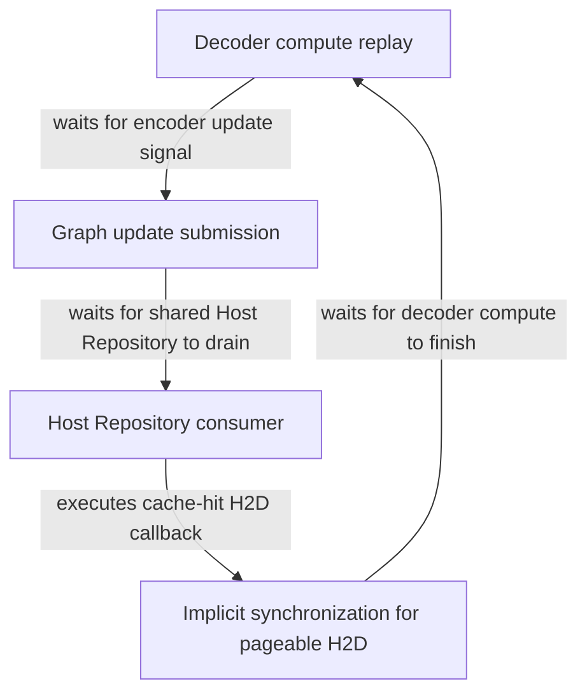
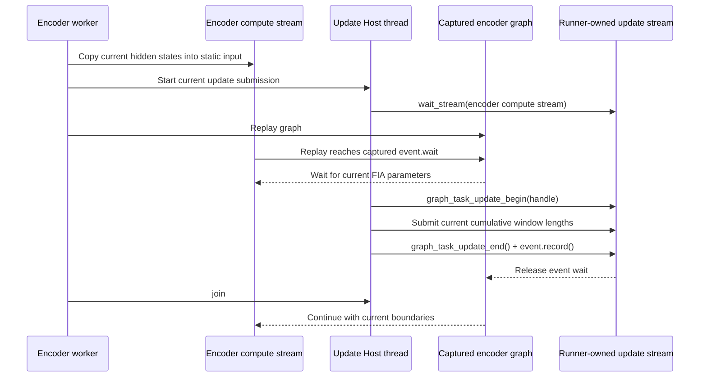

# From CANN 107033 to a Silent Stall: Debugging and Redesigning Qwen3-ASR Full-Graph Execution on Ascend

> This article documents an engineering investigation into Qwen3-ASR full-graph execution on Ascend in SGLang-Omni.
>
> - Implementation: [sglang-omni#2160](https://github.com/sgl-project/sglang-omni/pull/2160)
> - Roadmap: [sglang-omni#2076](https://github.com/sgl-project/sglang-omni/issues/2076)
> - 中文版：[qwen3-asr-ascend-graph-debugging.zh-CN.md](qwen3-asr-ascend-graph-debugging.zh-CN.md)
>
> This article explains the investigation and design rationale. The PR description and its Validation section remain authoritative for the current diff and qualification status. The results apply only to the stated versions, configuration, and workload; they are not a universal stability or performance claim.

## Summary

While enabling full-graph execution for Qwen3-ASR on Ascend NPU, we encountered two failures: CANN error 107033 and a silent, no-progress stall.

The investigation separated two mechanisms. Encoder and decoder graph-update transactions could contend on the same update stream and violate the CANN task-group state contract. With the default shared Host submission queue, a cache-hit H2D transfer could also create a cross-stream Host-side dependency with graph updates.

The final design does not add global locking or move cache transfers into the encoder worker. Each encoder graph runner owns its FIA update stream, and the NPU worker starts with `PER_STREAM_QUEUE=1` so distinct device streams use distinct Host queues. Cache hits retain the existing caller-thread attach path used by the GPU implementation.

## 1. Background

The target configuration combines:

- encoder graphs;
- breakable prefill graphs;
- full decode graphs;
- concurrent requests;
- both cache-hit and cache-miss audio admission paths.

A graph normally captures a device computation once and replays it against static buffers, reducing Python scheduling and operator-submission overhead.

The speech encoder adds another form of dynamism. Two inputs can have the same total token count and reuse the same graph bucket while carrying different audio-window layouts. Each Ascend fused-infer-attention (FIA) task captures host-side cumulative sequence boundaries, so every replay must update every FIA layer with the boundaries for the current input.

The simplified handshake is:

```text
prepare the current encoder input
  → enqueue graph replay
  → replay reaches the event wait before FIA
  → update FIA parameters on an update stream
  → record the completion event
  → continue replay with the current boundaries
```

The same service process also performs decoder graph replay and task updates. Its execution path includes multiple device streams, the torch_npu Host Repository, CPU-to-NPU transfers after cache hits, and futures that control request admission. The failure emerged at the boundary between these mechanisms rather than inside one isolated operator.

The main runtime investigated here used Python 3.11.10, PyTorch 2.10.0, torch_npu 2.10.0.post2, CANN 9.0.1, and unmodified SGLang v0.5.19 at `0bcd8223`.

## 2. Two Failures That Must Not Be Conflated

### 2.1 CANN 107033

One failure reported:

```text
ACL_ERROR_STREAM_TASK_GROUP_STATUS
Unable to start update tasks because the stream is busy
```

The version-matched CANN source shows that `StreamBeginTaskUpdate` requires the stream task-group state to be `NONE`, changes it to `UPDATE`, and relies on `StreamEndTaskUpdate` to restore it.

The following interleaving is therefore invalid:

```text
Encoder: BeginTaskUpdate
Decoder: BeginTaskUpdate   ← the stream is still in UPDATE, so 107033 is returned
Encoder: EndTaskUpdate
```

CANN's internal mutex protects an individual API call. It does not automatically make the caller's entire `Begin → operations → End` sequence atomic. Historical runs showed a shared update stream and 107033, but the first failure did not record the full identities of both transactions. Transaction overlap is therefore supported by both source and runtime evidence, but the exact pair involved in that first incident was not directly reconstructed.

### 2.2 Silent Stall

The second failure produced no Python exception and no clear CANN error. Requests stopped completing, threads remained around graph-update submission, and an external watchdog eventually had to terminate the process.

Later evidence showed that this was not simply another manifestation of 107033. Version-matched source, thread stacks, and a reduced probe preserving the execution mechanism support a bounded mechanism in which a shared Host queue, implicit H2D synchronization, and graph events form a dependency cycle. This does not establish that every historical stall had the same cause.

## 3. Hypotheses, Discriminating Tests, and Rejections

| Hypothesis | Discriminating check | Conclusion |
| --- | --- | --- |
| Encoder and decoder update transactions interleave on one update stream | Compare failure site, stream identities, and CANN source | Explains 107033, but not the later silent stall |
| The main problem is decoder helper-thread scheduling | Move decoder update submission to the caller thread | Several early rounds passed, but warmup and cold concurrent runs failed later; timing changed, ownership did not |
| One shared submission lock is sufficient | Lock wait, replay, Begin/End, and event record | Reduces transaction-overlap risk, but the full concurrent gate can still stall |
| A private encoder device stream provides isolation | Give each encoder runner its own update stream | The stall remains; separate device streams do not imply separate Host queues |
| torch_npu lost an EventFD wakeup | Inspect queue state, thread stacks, and double-check logic | Direct evidence was missing, and the source did not support a simple lost-wakeup claim |
| `non_blocking=True` guarantees that H2D cannot block the Host | Audit torch_npu/CANN copy paths and run controlled probes | False; pageable Host memory may still cause synchronous waiting |

These negative results mattered. A few passing stress rounds only show that one schedule did not trigger the bug; they do not prove that the modified thread was the defect owner.

## 4. Source Review Corrected the Mental Model

### 4.1 Device streams are not Host submission queues

Version-matched torch_npu source showed that, in the relevant queue mode, work for distinct NPU streams could still enter the same default Host Repository. Some stream conversion and graph-update operations drain the relevant Repository before returning the raw stream.

Therefore:

```text
different device streams ≠ different Host submission queues
```

This is why assigning a private device stream to the encoder was not sufficient on its own.

### 4.2 `non_blocking=True` is not an absolute runtime guarantee

Cached audio embeddings live on CPU. The old path called `.to(device, non_blocking=True)` from a request-building thread.

That flag describes the requested API behavior, not every lower-level condition. For pageable or unregistered Host memory, the runtime can still synchronize the target stream inside the copy path. The Python call may look asynchronous while the Host Repository consumer is blocked in a stream synchronization.

### 4.3 Per-stream Host queues preserve the existing cache path

An early repair moved cache-hit H2D into the encoder worker and delayed its future until stream synchronization. Later experiments showed that enabling `PER_STREAM_QUEUE=1` before NPU runtime initialization prevents distinct device streams from sharing the default Host queue, allowing the existing caller-thread attach path to remain stable. The final PR therefore removes the additional transfer type, worker-queue branch, and deferred-admission semantics.

## 5. The Bounded Silent-Stall Dependency Mechanism

A repaired diagnostic collector obtained complete thread stacks. Combined with version-matched torch_npu/CANN source and a reduced probe that preserved the same execution mechanism, the dependency chain was:



In short:

```text
compute waits for update
update waits for the Host queue
H2D work in the Host queue waits for compute
```

Controlled probes distinguished the relevant conditions:

- overlap with an ordinary pageable source reproduced the stall;
- removing the overlap completed;
- a pinned-source control completed;
- output checks passed, ruling out a simple data-corruption explanation.

The thread evidence placed the Repository consumer in the implicit H2D synchronization path, the copy submitter waiting for Repository capacity, and the graph updater waiting before stream acquisition or Repository drain.

There is still an evidence boundary: the exact final device task associated with the stalled event was not read directly from the device. The last signal relationship is partly code-derived from the reduced single-event program and API contracts. The evidence closes the causal loop for the reproduced silent-stall mechanism, but it does not prove that every historical failure had the same cause.

## 6. Final Design: Graph-Update Ownership and Host-Queue Isolation

### 6.1 Encoder-owned graph replay and FIA updates

Each encoder graph runner owns an update stream on the same device. During capture, the graph places an external event wait around every updatable FIA task. At replay time, the encoder worker starts a short-lived Host thread for the update submission while replaying the graph on the caller thread:



The initial `wait_stream` is a dependency edge, not a device-wide synchronization. It prevents the update sequence from overtaking encoder input preparation while preserving asynchronous graph execution.

The update thread and replay must make progress concurrently; captured event waits connect the consumer with the current FIA parameter update. The graph handle, update stream, task events, and static buffers belong to one runner. If capture fails for a bucket, only that bucket remains on the eager path; the current implementation does not add a separate terminal-failure state.

### 6.2 One graph per token bucket

Inputs in the same token bucket can carry different `effective_window_lens`. The final implementation stores one graph per bucket size and supplies the current cumulative window boundaries to every captured FIA task before each replay. Capture-local `attention_metadata` is passed explicitly through the layer stack so one capture's Host boundaries do not become mutable runner-wide state.

### 6.3 Per-stream Host queues and the cache path

The NPU pipeline defaults `PER_STREAM_QUEUE=1` before spawning workers. Explicit shell or pipeline settings take precedence. Graph startup also requires `TASK_QUEUE_ENABLE` to be unset, `1`, or `2`, and rejects `ASCEND_LAUNCH_BLOCKING=1`. These values must be established before torch_npu initialization because the runtime caches its Host-queue configuration.

Cache hits retain the existing caller-thread attach and already-completed future path. The final PR does not modify `encoder_service.py`, add a transfer type or second encoder queue, or introduce an additional stream synchronization.

### 6.4 Ownership contract

| Component | Owns | Completion signal |
| --- | --- | --- |
| Request-building thread | Request construction and the existing cache-hit attach | Keeps the existing completed-future contract |
| Encoder worker | Encoder batches and graph replay | Returns the encoder output after replay completes |
| Encoder compute stream | Static-input copy and encoder graph replay | Ordered by stream dependencies |
| Per-runner update stream | FIA task-group updates and completion events | Event records release graph replay |
| Per-stream Host queue | Isolation of Host submissions for distinct device streams | Configured before worker startup |

CUDA, ROCm, XPU, and CPU do not enable NPU graph-task updates; their existing graph replay, cache-hit, and eager-fallback behavior remains unchanged.

## 7. Why No SGLang Patch Is Required

The final change is contained in SGLang-Omni's encoder graph capture/replay and NPU worker startup configuration:

- the encoder runner owns the full NPU graph-update lifecycle;
- FIA Host parameters are updated with the current window boundaries before each replay;
- per-stream Host queues isolate submissions from distinct device streams;
- cache-hit H2D retains the existing SGLang-Omni path.

The design therefore works with unmodified SGLang v0.5.19 at `0bcd8223` and does not depend on SGLang PR #40059.

## 8. Validation and Evidence Boundaries

### Completed qualification

Native CPU regression on the qualified candidate reported:

```text
562 passed, 1 guarded XPU skip, 2 accelerator deselected
```

One cold-start, concurrency-8, 140-input all-graph run completed with 140/140 successful HTTP responses, no failures, empty transcripts, or high-WER samples, corpus WER `0.011373`, and zero per-sample disagreement against the retained reference. Decode graph runtime counters reported no eager fallback, and shutdown and resource cleanup completed normally.

A subsequent 20-round independent cold-start stability run completed 2800/2800 HTTP 200 responses. Every round produced WER `0.011373`; reference disagreement, decode fallback, watchdog triggers, and forced shutdowns were all zero.

After conflict resolution, merge head `b8ea8032` completed native CPU regression and another 3/3 independent cold-start rounds: 420/420 HTTP 200 responses, unchanged WER, zero decode fallback, zero watchdog triggers, and normal cleanup.

### Current head must not inherit older hardware evidence

At this article update, the PR head is `8fe0e163` on base `d290c100`. The current code has removed the worker-owned cached-transfer and terminal graph-failure mechanisms in favor of per-stream Host queues plus the existing cache-attach path.

The current head has source-isolated graph, environment-default, startup-contract, targeted pre-commit, and diff checks. The hardware results above directly qualify older heads `555c6906` and `b8ea8032`. A per-stream-queue experiment also reported 19/19 completed phases, median throughput `+0.8%`, and p95 `-0.5%`, but that result is not complete current-head qualification for `8fe0e163`. Refer to [PR #2160](https://github.com/sgl-project/sglang-omni/pull/2160) for the latest Validation section and checklist.

Additional boundaries:

- server results were operator-reported; retained raw artifacts were not independently imported and recomputed locally;
- update-stream ownership is supported by pinned source and tests, but runtime stream handles were not directly sampled;
- encoder capture markers are not per-replay counters, so exact encoder replay counts remain unmeasured;
- the results cover fixed versions, configuration, and the SeedTTS EN workload, not every Ascend deployment.

## 9. Engineering Lessons

1. **Passing a few stress rounds does not establish root cause.** Moving work between threads, adding a lock, or changing streams may only alter failure probability.
2. **Device streams and Host submission queues must be analyzed separately.** Isolation of one does not imply isolation of the other.
3. **`non_blocking=True` is not an absolute asynchronous guarantee.** Host-memory type and runtime implementation still matter.
4. **Host-queue topology must match the multi-stream submission model.** After isolating device streams, verify whether their Host work still enters one queue.
5. **A durable fix removes the invalid dependency instead of accumulating synchronization.** The final design uses per-stream Host queues instead of adding a transfer worker or global lock.
6. **Error codes and silent stalls need separate evidence chains.** They share an ownership problem, but they are not one failure.
7. **Implementation, tests, and documentation must describe the same current contract.** A reverted experimental design must not remain in the PR description or architecture write-up.

The redesign ultimately clarified three boundaries:

```text
who owns encoder graph updates
how device streams map to Host submission queues
who owns the complete graph-update transaction lifecycle
```

Once those boundaries became explicit, correctness stopped depending on favorable scheduling and became a set of explainable dependencies and testable failure semantics.
