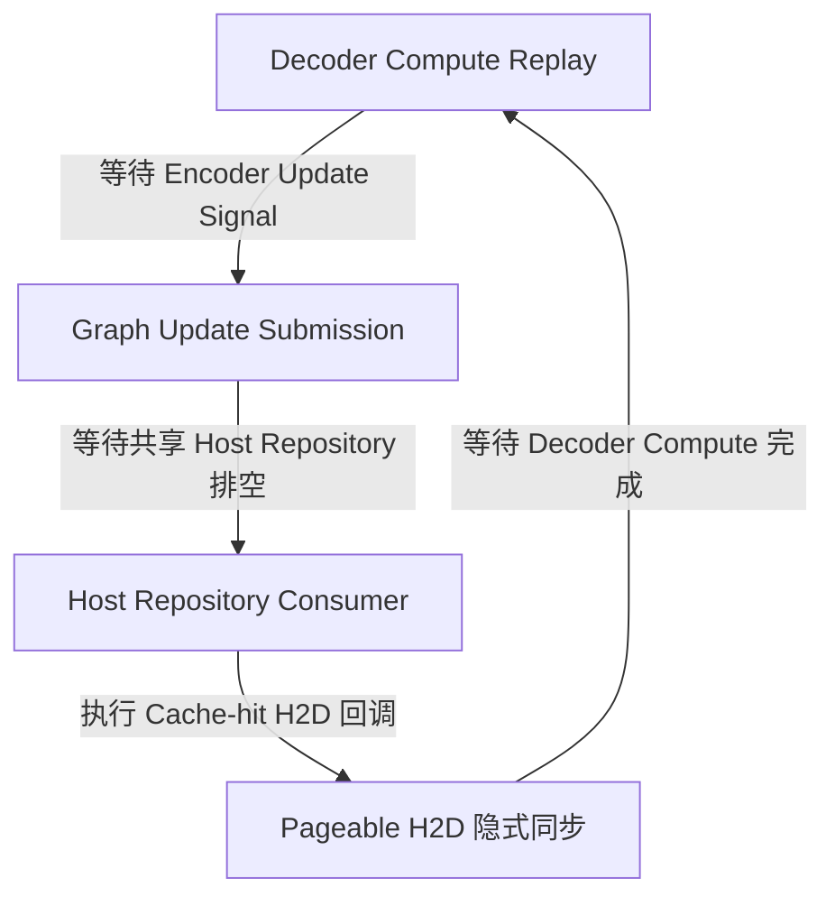
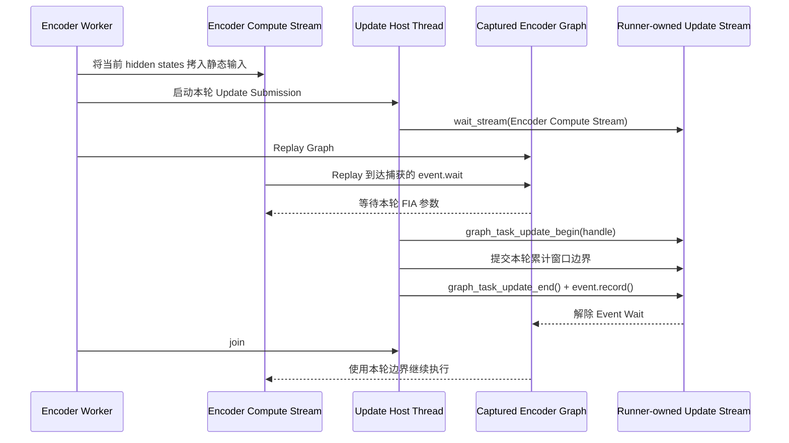

# 从 107033 到静默卡死：Qwen3-ASR Ascend 全图适配的问题定位与架构修复

> 本文记录 SGLang-Omni Qwen3-ASR Ascend 全图适配中的一次工程排障。
>
> - 对应实现：[sglang-omni#2160](https://github.com/sgl-project/sglang-omni/pull/2160)
> - 对应路线图：[sglang-omni#2076](https://github.com/sgl-project/sglang-omni/issues/2076)
> - English version: [qwen3-asr-ascend-graph-debugging.en.md](qwen3-asr-ascend-graph-debugging.en.md)
>
> 本文负责解释调查过程和设计依据。PR 描述及其 Validation 部分才是当前代码与验证状态的权威来源。文中的结果仅覆盖注明的版本、配置和工作负载，并非对所有环境的普遍稳定性或性能承诺。

## 摘要

我们在为 Qwen3-ASR 启用 Ascend NPU 全图执行时，先后遇到了 CANN 107033 错误和无异常、无进展的静默卡死。

调查最终区分出两类问题：Graph Update 事务可能争用同一更新流，导致 Task Group 状态错误；默认共享 Host 提交队列时，缓存命中后的 H2D 又可能与 Graph Update 形成跨 Stream 的 Host 侧依赖。

最终方案没有继续堆叠锁，也没有把缓存搬运迁入 Encoder Worker。每个 Encoder Graph Runner 独立拥有 FIA Graph Update Stream；NPU Worker 启动前启用 `PER_STREAM_QUEUE=1`，让不同 Device Stream 的 Host 任务进入各自队列。缓存命中继续使用与 GPU 一致的调用线程 Attach 路径。

## 一、基本背景

目标是在 SGLang-Omni 中让 Qwen3-ASR 稳定运行以下组合：

- Encoder Graph；
- Breakable Prefill Graph；
- Full Decode Graph；
- 多请求并发；
- 缓存命中和未命中两条音频准入路径。

计算图通常会把一段设备计算捕获下来，后续使用静态缓冲区重复 replay，从而减少 Python 调度和算子提交开销。

但语音 Encoder 存在额外动态性：两个输入即使总 token 数相同、落入同一个 Graph Bucket，它们的音频窗口布局也可能不同。Ascend fused-infer-attention（FIA）任务捕获了 Host 侧累计序列边界，所以每次 replay 前都必须为每层 FIA Task 更新本轮窗口边界。

简化后的握手过程是：

```text
准备本轮 Encoder 输入
  → 提交 Graph Replay
  → Replay 到达 FIA 前的 Event Wait
  → 在 Update Stream 更新 FIA 参数
  → Record Event
  → Graph 使用本轮边界继续执行
```

同一个服务进程里，Decoder 也有 Graph Replay 和任务更新。同时系统还包含 torch_npu Host Repository、多个设备流、缓存命中后的 CPU→NPU 搬运，以及请求准入 Future。故障发生在这些机制的组合边界，而不是单个算子本身。

本次调查所对应的主要运行时为 Python 3.11.10、PyTorch 2.10.0、torch_npu 2.10.0.post2、CANN 9.0.1，以及未修改的 SGLang v0.5.19 `0bcd8223`。

## 二、两个不能混为一谈的故障

### 1. CANN 107033

运行时曾出现：

```text
ACL_ERROR_STREAM_TASK_GROUP_STATUS
Unable to start update tasks because the stream is busy
```

版本匹配的 CANN 源码表明，`StreamBeginTaskUpdate` 要求目标 Stream 的 Task Group 状态为 `NONE`，随后把它置为 `UPDATE`，直到 `StreamEndTaskUpdate` 才恢复。

因此下面的交错不合法：

```text
Encoder: BeginTaskUpdate
Decoder: BeginTaskUpdate   ← Stream 仍处于 UPDATE，返回 107033
Encoder: EndTaskUpdate
```

CANN 内部互斥只保护单次 API 调用，不会自动把调用方的 `Begin → Operations → End` 变成一个完整事务。历史运行中观察到了共享更新流与 107033，但第一次失败没有同时记录两个事务的完整身份。因此，事务交错是源码和运行现象共同支持的解释，但不是对首次现场冲突双方的直接重建。

### 2. 静默卡死

另一类故障没有 Python 异常，也没有明确的 CANN 错误：请求停止完成，线程停在 Graph Update 附近，最后只能由看门狗终止。

后续调查表明，它不是 107033 的另一种表现。版本匹配源码、线程栈和保留相同执行机制的最小复现共同支持一个有界机制：共享 Host 提交队列、H2D 隐式同步和 Graph Event 可以形成循环依赖。该证据不能证明所有历史卡死都来自同一个机制。

## 三、假设如何被逐步验证和淘汰

| 假设 | 判别方式 | 结论 |
| --- | --- | --- |
| Encoder 与 Decoder 在共享 Update Stream 上发生事务交错 | 对照错误位置、Stream 身份和 CANN 源码 | 可以解释 107033，但不足以解释后续静默卡死 |
| 主要问题是 Decoder 后台线程的调度顺序 | 把 Decoder Update 移到调用线程 | 短期多轮通过，后续仍在 Warmup 和冷启动并发中失败，只改变了时序 |
| 为所有 Graph Submission 增加共享锁即可 | 锁住 wait、replay、Begin/End 和 Event Record | 减少事务交错风险，但完整并发门禁仍可卡死 |
| Encoder 使用私有 Device Stream 就已经隔离 | 为 Encoder Graph Runner 创建独立 Update Stream | 仍可卡死；不同 Device Stream 不等于不同 Host Queue |
| torch_npu 发生了 EventFD 丢失唤醒 | 检查队列、线程栈和源码二次检查 | 缺少直接证据，源码也不支持简单的 lost-wakeup 结论 |
| `non_blocking=True` 保证 H2D 不阻塞 Host | 审计 torch_npu/CANN Copy 路径并构造对照实验 | 不成立；Pageable Host Memory 仍可能触发同步等待 |

这些反例很关键：连续数轮通过只能说明某种时序下没有触发故障，不能证明被修改的线程就是根因。

## 四、源码审计修正了哪些错误认识

### Device Stream 不等于 Host Submission Queue

torch_npu 的版本匹配源码显示，在当前队列模式下，不同 NPU Stream 的任务仍可能进入同一个默认 Host Repository。部分 Stream 转换和 Graph Update API 在取得底层 Stream 前，会等待相关 Repository 排空。

因此：

```text
不同 Device Stream ≠ 不同 Host Submission Queue
```

这解释了为什么“给 Encoder 换一条私有 Stream”仍然不能独立消除卡死。

### `non_blocking=True` 不等于运行时绝不会同步

缓存中的音频 Embedding 位于 CPU。旧路径从请求构造线程调用 `.to(device, non_blocking=True)`。

但 `non_blocking=True` 只表达调用意图。对于 Pageable 或未注册的 Host Memory，底层运行时仍可能在 Copy 回调中同步目标设备流。也就是说，Python 调用形式看起来是异步的，Host Repository Consumer 却可能阻塞在 `StreamSynchronize`。

### Per-stream Host Queue 保留了原有缓存路径

一种早期修复把缓存命中后的 H2D 搬到 Encoder Worker，并让请求 Future 等待 Stream 同步。后续实验表明，在 NPU Runtime 初始化前启用 `PER_STREAM_QUEUE=1` 后，不同 Device Stream 不再共用默认 Host 提交队列，原有调用线程 Attach 路径可以稳定保留。因此最终 PR 回退了这套额外的 Transfer 类型、Worker Queue 分支和 Deferred Admission 语义。

## 五、静默卡死的有界依赖机制

修复后的诊断采集器取得了完整线程栈。结合 torch_npu/CANN 源码和保留相同执行机制的最小复现，等待关系可以概括为：



也就是：

```text
Compute 等待 Update
Update 等待 Host Queue
Host Queue 中的 H2D 等待 Compute
```

对照实验进一步区分了关键条件：

- 普通 Pageable Source 加任务重叠时可以复现卡死；
- 禁止相关重叠时能够完成；
- 使用满足条件的 Pinned Source 时能够完成；
- 输出校验正确，排除了单纯的数据错误。

线程栈还显示 Repository Consumer 位于 H2D 的隐式同步路径，Copy 提交线程等待 Repository 空闲，Graph Updater 则在取得 Stream 或等待 Repository 排空。

证据边界也必须说明：卡死现场没有直接读取设备上最后一个 Event 对应的具体 Task。循环中的最终信号对应关系，部分来自最小复现、单事件程序结构和 API 契约，而不是设备任务级的直接观测。这个机制对复现出的静默卡死形成了因果闭环，但不意味着历史上所有失败都必然来自同一个原因。

## 六、最终修改方案：Graph Update 所有权与 Host Queue 隔离

### 1. Encoder Runner 拥有 Graph Replay 和 FIA Update

每个 Encoder Graph Runner 拥有一条同设备的 Update Stream。捕获图在每个可更新 FIA Task 周围建立 External Event Wait。Replay 时，Encoder Worker 启动一个短生命周期 Host Thread 提交 Update，同时在当前线程执行 Graph Replay：



开头的 `wait_stream` 是依赖边，不是全设备同步：它防止 Update 越过 Encoder 输入准备，同时保留异步 Graph Execution。

Update Thread 和 Replay 必须并发推进；捕获的 Event Wait 负责连接消费者和本轮 FIA 参数更新。Graph Handle、Update Stream、Task Event 和静态缓冲区都归同一个 Runner。某个 Bucket 捕图失败时只把该 Bucket 留在 Eager 路径；当前实现不引入额外的 Terminal Failure State。

### 2. 一张图对应一个 Token Bucket

同一 Token Bucket 内，不同输入可能具有不同的 `effective_window_lens`。最终实现只按 Bucket Size 保存一张图，并在每次 Replay 时把本轮累计窗口边界传给所有捕获的 FIA Task。Capture-local `attention_metadata` 显式传入 Layer Stack，避免某次捕图的 Host 边界成为 Runner 范围内的可变状态。

### 3. Per-stream Host Queue 与缓存路径

NPU Pipeline 在启动 Worker 之前默认设置 `PER_STREAM_QUEUE=1`。显式的 Shell 或 Pipeline 环境设置优先；Graph Startup 同时要求 `TASK_QUEUE_ENABLE` 为未设置、`1` 或 `2`，且 `ASCEND_LAUNCH_BLOCKING` 不能为 `1`。这些值必须在 torch_npu 初始化前确定，因为 Runtime 会缓存 Host Queue 配置。

缓存命中继续沿用原有调用线程 Attach 和 Already-completed Future 路径。最终 PR 不修改 `encoder_service.py`，不增加 Transfer 类型、第二条 Encoder Queue 或额外的 Stream Synchronize。

### 4. 所有权契约

| 组件 | 拥有的工作 | 完成信号 |
| --- | --- | --- |
| Request Builder | 请求构造与原有 Cache-hit Attach | 保留原有 Completed Future 契约 |
| Encoder Worker | Encoder Batch 与 Graph Replay | Replay 完成后返回 Encoder 输出 |
| Encoder Compute Stream | 静态输入 Copy 与 Encoder Graph Replay | 由 Stream Dependency 保证顺序 |
| Runner-owned Update Stream | FIA Task Group 更新和完成事件 | Event Record 解除 Graph Replay |
| Per-stream Host Queue | 隔离不同 Device Stream 的 Host 任务提交 | 在 Worker 启动前由 Runtime 环境配置 |

CUDA、ROCm、XPU 和 CPU 不启用 NPU Graph-task Update，原有 Graph Replay、Cache Hit 和 Eager Fallback 行为保持不变。

## 七、为什么最终不需要修改 SGLang

最终修复针对的是 SGLang-Omni 自身的 Encoder Graph Capture/Replay 和 NPU Worker 启动配置：

- Encoder Runner 拥有完整的 NPU Graph Update 生命周期；
- FIA Host 参数在每次 Replay 时按当前窗口边界更新；
- Per-stream Host Queue 隔离不同 Device Stream 的 Host 提交；
- Cache-hit H2D 保留原有 SGLang-Omni 路径。

因此，该方案可以在未修改的 SGLang v0.5.19 `0bcd8223` 上运行，不依赖 SGLang #40059。

## 八、验证与证据边界

### 已完成验证

候选版本的原生 CPU 回归为：

```text
562 passed, 1 guarded XPU skip, 2 accelerator deselected
```

单轮冷启动、并发 8、140 输入的全图验证结果包括：140/140 HTTP 成功，失败、空结果和高 WER 均为 0，Corpus WER 为 `0.011373`，与保留参考逐样本分歧为 0；Decode Graph 运行计数中 False 为 0，并完成正常 SIGTERM 和资源清理。

随后完成 20 轮独立冷启动稳定性验证，共 2800/2800 HTTP 200；每轮 WER 均为 `0.011373`，参考分歧、Decode Fallback、Watchdog Trigger 均为 0，20/20 正常退出并回收资源。

冲突合并后的 `b8ea8032` 又完成了原生 CPU 回归和 3/3 独立冷启动，共 420/420 HTTP 200，结果一致、无 Decode Fallback、无 Watchdog Trigger并正常清理。

### 当前 Head 与历史硬件结果不能混写

截至本文本次更新，PR 当前 Head 为 `8fe0e163`，Base 为 `d290c100`。当前代码已经删除 Worker-owned Cached Transfer 和 Terminal Graph Failure 机制，改为 Per-stream Host Queue 加原有 Cache Attach 路径。

当前 Head 已通过 Source-isolated Graph、环境默认值、启动条件检查、Targeted Pre-commit 和 Diff Audit；但上述硬件结果直接覆盖的是更早的 `555c6906` 和 `b8ea8032`。Per-stream Queue 实验还报告了 19/19 阶段通过、吞吐量中位数 `+0.8%`、P95 `-0.5%`，但该结果不是 `8fe0e163` 的完整 Current-head Qualification。最新状态应以 [PR #2160](https://github.com/sgl-project/sglang-omni/pull/2160) 的 Validation 和 Checklist 为准。

此外：

- 服务器结果由操作者报告，保留的原始 Artifact 未在本地独立导入重算；
- Encoder Update Stream Ownership 有固定版本源码和测试支撑，但运行期 Stream Handle 没有直接采样；
- Encoder Capture Marker 不能替代逐次 Replay Counter，精确 Replay 次数仍未直接测量；
- 结果只覆盖固定版本、配置和 SeedTTS EN 工作负载，不构成普遍稳定性或性能声明。

## 九、这次适配留下的工程经验

1. **短期压力测试通过不等于找到根因。** 改线程、加锁或换 Stream 都可能只改变故障概率。
2. **Device Stream 和 Host Submission Queue 必须分开分析。** 前者隔离不代表后者隔离。
3. **`non_blocking=True` 不是绝对异步保证。** Host Memory 类型和 Runtime 路径仍可能引入同步。
4. **Host Queue 拓扑必须与多 Stream 提交模型一致。** Device Stream 隔离之后，还要确认 Host 任务是否仍进入同一队列。
5. **修复应该删除错误依赖，而不是持续增加同步。** 本次最终方案通过 Per-stream Host Queue 移除跨 Stream 的 Host 队列依赖，而不是增加 Transfer Worker 或全局锁。
6. **错误码与静默卡死要分别建立证据链。** 它们共享所有权不清的背景，但不是同一个故障。
7. **实现、测试和说明必须描述同一份当前契约。** 被回退的实验方案不能继续留在 PR 描述或架构文档中。

最终，这次修改明确了三个边界：

```text
谁拥有 Encoder Graph Update
Device Stream 如何映射到 Host Submission Queue
谁负责 Graph Update 事务的完整生命周期
```

当这些边界明确以后，系统才从依赖调度运气，转变为依赖关系可以解释、失败语义可以测试的实现。
