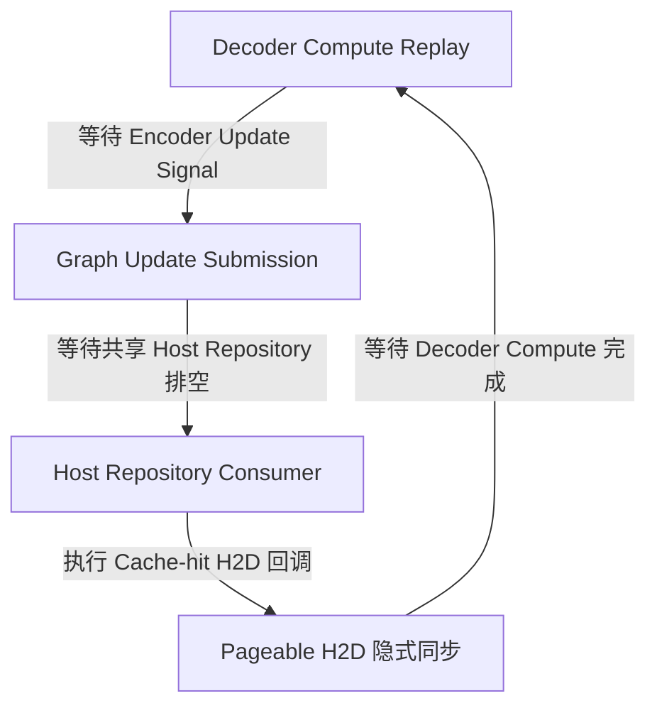
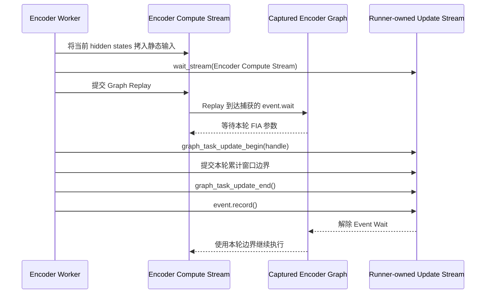
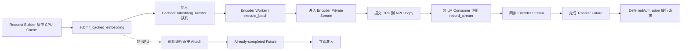

# 从 107033 到静默卡死：Qwen3-ASR Ascend 全图适配的问题定位与架构修复

> 本文记录 SGLang-Omni Qwen3-ASR Ascend 全图适配中的一次工程排障。
>
> - 对应实现：[sglang-omni#2160](https://github.com/sgl-project/sglang-omni/pull/2160)
> - 对应路线图：[sglang-omni#2076](https://github.com/sgl-project/sglang-omni/issues/2076)
> - English version: [qwen3-asr-ascend-graph-debugging.en.md](qwen3-asr-ascend-graph-debugging.en.md)
>
> 本文负责解释调查过程和设计依据。PR 描述及其 Validation 部分才是当前代码与验证状态的权威来源。文中的结果仅覆盖注明的版本、配置和工作负载，并非对所有环境的普遍稳定性或性能承诺。

## 摘要

我们在为 Qwen3-ASR 启用 Ascend NPU 全图执行时，先后遇到了 CANN 107033 错误和无异常、无进展的静默卡死。

调查最终区分出两类问题：Graph Update 事务可能争用同一更新流，导致 Task Group 状态错误；缓存命中后的 H2D 又可能从请求构造线程进入共享 Host 提交队列，在特定内存和时序条件下，与 Decoder Compute 和 Encoder Update Signal 形成循环等待。

最终修复没有继续堆叠锁或调整线程时序，而是重新定义设备工作的所有权：Encoder Graph Runner 独立拥有 FIA Graph Update，Encoder Worker 独立拥有 NPU Cached Embedding Transfer，请求只有在 Embedding 真正可供 LM 消费后才完成准入。

## 一、基本背景

目标是在 SGLang-Omni 中让 Qwen3-ASR 稳定运行以下组合：

- Encoder Graph；
- Breakable Prefill Graph；
- Full Decode Graph；
- 多请求并发；
- 缓存命中和未命中两条音频准入路径。

计算图通常会把一段设备计算捕获下来，后续使用静态缓冲区重复 replay，从而减少 Python 调度和算子提交开销。

但语音 Encoder 存在额外动态性：两个输入即使总 token 数相同、落入同一个 Graph Bucket，它们的音频窗口布局也可能不同。Ascend fused-infer-attention（FIA）任务捕获了 Host 侧累计序列边界，所以每次 replay 前都必须为每层 FIA Task 更新本轮窗口边界。

简化后的握手过程是：

```text
准备本轮 Encoder 输入
  → 提交 Graph Replay
  → Replay 到达 FIA 前的 Event Wait
  → 在 Update Stream 更新 FIA 参数
  → Record Event
  → Graph 使用本轮边界继续执行
```

同一个服务进程里，Decoder 也有 Graph Replay 和任务更新。同时系统还包含 torch_npu Host Repository、多个设备流、缓存命中后的 CPU→NPU 搬运，以及请求准入 Future。故障发生在这些机制的组合边界，而不是单个算子本身。

本次调查所对应的主要运行时为 Python 3.11.10、PyTorch 2.10.0、torch_npu 2.10.0.post2、CANN 9.0.1，以及未修改的 SGLang v0.5.19 `0bcd8223`。

## 二、两个不能混为一谈的故障

### 1. CANN 107033

运行时曾出现：

```text
ACL_ERROR_STREAM_TASK_GROUP_STATUS
Unable to start update tasks because the stream is busy
```

版本匹配的 CANN 源码表明，`StreamBeginTaskUpdate` 要求目标 Stream 的 Task Group 状态为 `NONE`，随后把它置为 `UPDATE`，直到 `StreamEndTaskUpdate` 才恢复。

因此下面的交错不合法：

```text
Encoder: BeginTaskUpdate
Decoder: BeginTaskUpdate   ← Stream 仍处于 UPDATE，返回 107033
Encoder: EndTaskUpdate
```

CANN 内部互斥只保护单次 API 调用，不会自动把调用方的 `Begin → Operations → End` 变成一个完整事务。历史运行中观察到了共享更新流与 107033，但第一次失败没有同时记录两个事务的完整身份。因此，事务交错是源码和运行现象共同支持的解释，但不是对首次现场冲突双方的直接重建。

### 2. 静默卡死

另一类故障没有 Python 异常，也没有明确的 CANN 错误：请求停止完成，线程停在 Graph Update 附近，最后只能由看门狗终止。

后续调查证明，它不是 107033 的另一种表现，而是 Host 提交队列、H2D 隐式同步和 Graph Event 之间形成的循环依赖。

## 三、假设如何被逐步验证和淘汰

| 假设 | 判别方式 | 结论 |
| --- | --- | --- |
| Encoder 与 Decoder 在共享 Update Stream 上发生事务交错 | 对照错误位置、Stream 身份和 CANN 源码 | 可以解释 107033，但不足以解释后续静默卡死 |
| 主要问题是 Decoder 后台线程的调度顺序 | 把 Decoder Update 移到调用线程 | 短期多轮通过，后续仍在 Warmup 和冷启动并发中失败，只改变了时序 |
| 为所有 Graph Submission 增加共享锁即可 | 锁住 wait、replay、Begin/End 和 Event Record | 减少事务交错风险，但完整并发门禁仍可卡死 |
| Encoder 使用私有 Device Stream 就已经隔离 | 为 Encoder Graph Runner 创建独立 Update Stream | 仍可卡死；不同 Device Stream 不等于不同 Host Queue |
| torch_npu 发生了 EventFD 丢失唤醒 | 检查队列、线程栈和源码二次检查 | 缺少直接证据，源码也不支持简单的 lost-wakeup 结论 |
| `non_blocking=True` 保证 H2D 不阻塞 Host | 审计 torch_npu/CANN Copy 路径并构造对照实验 | 不成立；Pageable Host Memory 仍可能触发同步等待 |

这些反例很关键：连续数轮通过只能说明某种时序下没有触发故障，不能证明被修改的线程就是根因。

## 四、源码审计修正了哪些错误认识

### Device Stream 不等于 Host Submission Queue

torch_npu 的版本匹配源码显示，在当前队列模式下，不同 NPU Stream 的任务仍可能进入同一个默认 Host Repository。部分 Stream 转换和 Graph Update API 在取得底层 Stream 前，会等待相关 Repository 排空。

因此：

```text
不同 Device Stream ≠ 不同 Host Submission Queue
```

这解释了为什么“给 Encoder 换一条私有 Stream”仍然不能独立消除卡死。

### `non_blocking=True` 不等于运行时绝不会同步

缓存中的音频 Embedding 位于 CPU。旧路径从请求构造线程调用 `.to(device, non_blocking=True)`。

但 `non_blocking=True` 只表达调用意图。对于 Pageable 或未注册的 Host Memory，底层运行时仍可能在 Copy 回调中同步目标设备流。也就是说，Python 调用形式看起来是异步的，Host Repository Consumer 却可能阻塞在 `StreamSynchronize`。

### Future 的“完成”含义不准确

旧实现先执行缓存 Attach，然后立即返回一个已完成 Future。这个 Future 实际表达的是“发现缓存并发起搬运”，上层却把它理解成“Embedding 已经可以安全交给 LM”。

设备工作的真正完成状态和请求准入状态因此发生了错位。

## 五、静默卡死的因果链

修复后的诊断采集器取得了完整线程栈。结合 torch_npu/CANN 源码和保留相同执行机制的最小复现，等待关系可以概括为：



也就是：

```text
Compute 等待 Update
Update 等待 Host Queue
Host Queue 中的 H2D 等待 Compute
```

对照实验进一步区分了关键条件：

- 普通 Pageable Source 加任务重叠时可以复现卡死；
- 禁止相关重叠时能够完成；
- 使用满足条件的 Pinned Source 时能够完成；
- 输出校验正确，排除了单纯的数据错误。

线程栈还显示 Repository Consumer 位于 H2D 的隐式同步路径，Copy 提交线程等待 Repository 空闲，Graph Updater 则在取得 Stream 或等待 Repository 排空。

证据边界也必须说明：卡死现场没有直接读取设备上最后一个 Event 对应的具体 Task。循环中的最终信号对应关系，部分来自最小复现、单事件程序结构和 API 契约，而不是设备任务级的直接观测。这个机制对复现出的静默卡死形成了因果闭环，但不意味着历史上所有失败都必然来自同一个原因。

## 六、最终修改方案：重新建立设备工作所有权

### 1. Encoder Runner 拥有 Graph Replay 和 FIA Update

每个 Encoder Graph Runner 拥有一条同设备的 Update Stream。捕获图在每个可更新 FIA Task 周围建立 External Event Wait；Replay 时由 Encoder Worker 完成同一套握手：



开头的 `wait_stream` 是依赖边，不是全设备同步：它防止 Update 越过 Encoder 输入准备，同时保留异步 Graph Execution。

Replay 有意先于 Update 提交，因为捕获图已经在 FIA Task 前等待对应 Event。Replay 建立消费者一侧的等待，后续 Event Record 使用本轮参数释放它。

Graph Handle、Update Stream、Task Event 和 Failure State 现在具有同一个所有者与生命周期。如果 Replay、Update Begin/End、FIA Operation 或 Event Record 在握手开始后失败，重试可能留下一个永远等不到 Signal 的 Graph，因此这类失败会终止 Encoder Worker。捕获上下文之前的 Allocation、Eager Warmup、Pool 或 Backend Setup 失败则只让当前 Bucket 回退到 Eager。

### 2. Encoder Worker 拥有 NPU Cached Embedding Transfer

NPU Cache Hit 不再从 Request Builder 直接提交 H2D，而是转化为 `CachedEmbeddingTransfer`，进入 Encoder Service 的单 Worker 队列：



Future 的完成语义由此变成：

```text
旧：Future ready = 已命中缓存并尝试发起 Copy
新：Future ready = Embedding 已经能够被 LM 安全消费
```

Worker 会保留 CPU Source，避免 Cache Eviction 使异步 Copy 的来源失效；对 LM Consumer Stream 调用 `record_stream()`，保证 Allocator 生命周期；同步 Transfer Stream 后才完成 Future。`record_stream()` 只解决存储生命周期，并不能单独证明 H2D 已完成，因此不能替代准入前的同步。

Transfer 失败会拒绝请求准入。Single-flight Follower 复用 Leader 已完成的设备工作，只发布已经就绪的 Embedding 元数据，不从回调线程重复提交设备任务。

### 3. 所有权与完成契约

| 组件 | 拥有的工作 | 完成信号 |
| --- | --- | --- |
| Request Builder | 请求构造与 Deferred Admission | 不提交 NPU Cached Transfer |
| Encoder Worker | Encoder Batch 与 NPU Cache-hit Transfer | Stream 同步成功后完成 Future |
| Encoder Compute Stream | 静态输入 Copy、Encoder Graph Replay 和 Transfer | 由 Stream Dependency 保证顺序 |
| Runner-owned Update Stream | FIA Task Group 更新和完成事件 | Event Record 解除 Graph Replay |
| LM/Default Stream | 消费 Ready Embedding | 使用 `record_stream()`维护 Allocator 生命周期 |

CUDA、ROCm、XPU 和 CPU 保留原来的调用线程 Attach 和 Already-completed Future，不进入 NPU Transfer Queue；非 NPU Graph Replay 和 Eager Fallback 也保持原行为。

## 七、为什么最终不需要修改 SGLang

最终修复针对的是 SGLang-Omni 自身的任务所有权和准入协议：

- Encoder Runner 拥有完整的 NPU Graph Update 生命周期；
- Encoder Worker 拥有 Cache-hit H2D；
- Request Builder 不再向共享设备提交路径插入 NPU Copy；
- 请求只在 Embedding 真正 Ready 后进入 LM。

因此，该方案可以在未修改的 SGLang v0.5.19 `0bcd8223` 上运行，不依赖 SGLang #40059。

## 八、验证与证据边界

### 已完成验证

候选版本的原生 CPU 回归为：

```text
562 passed, 1 guarded XPU skip, 2 accelerator deselected
```

单轮冷启动、并发 8、140 输入的全图验证结果包括：140/140 HTTP 成功，失败、空结果和高 WER 均为 0，Corpus WER 为 `0.011373`，与保留参考逐样本分歧为 0；Decode Graph 运行计数中 False 为 0，并完成正常 SIGTERM 和资源清理。

随后完成 20 轮独立冷启动稳定性验证，共 2800/2800 HTTP 200；每轮 WER 均为 `0.011373`，参考分歧、Decode Fallback、Watchdog Trigger 均为 0，20/20 正常退出并回收资源。

冲突合并后的 `b8ea8032` 又完成了原生 CPU 回归和 3/3 独立冷启动，共 420/420 HTTP 200，结果一致、无 Decode Fallback、无 Watchdog Trigger并正常清理。

### 当前 Head 与历史硬件结果不能混写

截至本文发布准备时，PR 当前 Squashed Head 为 `f560a3c7`。它包含 Review Cleanup，包括收窄终止性捕获失败的分类、把 Worker-owned Cached Transfer 限定在 NPU，以及澄清 Metadata-only Helper 命名。

当前 Head 已通过 Source-isolated CPU Checks、Compile、Targeted Pre-commit 和 Diff Audit；但上述硬件结果直接覆盖的是 `555c6906` 和 `b8ea8032`，不是 `f560a3c7`。最新状态应以 [PR #2160](https://github.com/sgl-project/sglang-omni/pull/2160) 的 Validation 和 Checklist 为准。

此外：

- 服务器结果由操作者报告，保留的原始 Artifact 未在本地独立导入重算；
- Encoder Update Stream Ownership 有固定版本源码和测试支撑，但运行期 Stream Handle 没有直接采样；
- Encoder Capture Marker 不能替代逐次 Replay Counter，精确 Replay 次数仍未直接测量；
- 结果只覆盖固定版本、配置和 SeedTTS EN 工作负载，不构成普遍稳定性或性能声明。

## 九、这次适配留下的工程经验

1. **短期压力测试通过不等于找到根因。** 改线程、加锁或换 Stream 都可能只改变故障概率。
2. **Device Stream 和 Host Submission Queue 必须分开分析。** 前者隔离不代表后者隔离。
3. **`non_blocking=True` 不是绝对异步保证。** Host Memory 类型和 Runtime 路径仍可能引入同步。
4. **Future 的完成语义必须对应下游可消费状态。** “已提交”与“已完成”不能混用。
5. **修复应该删除错误依赖，而不是持续增加同步。** 本次关键是收回设备提交所有权，而不是再加一把锁。
6. **错误码与静默卡死要分别建立证据链。** 它们共享所有权不清的背景，但不是同一个故障。
7. **实现、测试和说明必须使用同一份完成契约。** 谁提交设备工作，谁就应拥有生命周期、完成信号和失败处理。

最终，这次修改明确了三个边界：

```text
谁拥有设备提交
谁决定请求可以进入下一阶段
谁负责 Graph Update 事务的完整生命周期
```

当这些边界明确以后，系统才从依赖调度运气，转变为依赖关系可以解释、失败语义可以测试的实现。
